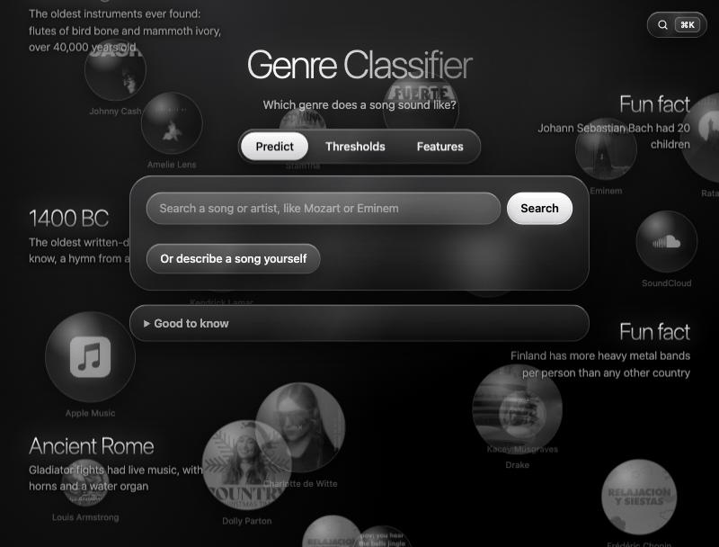

# Spotify Genre Classifier

Guessing the genre of a song (classical, country, heavy-metal, hip-hop, jazz or techno) from how it sounds, using Spotify's audio features.

*The app: search a song with ⌘K, get the predicted genre with the song's music video, change the thresholds and watch the test results change, and see which features the model listens to most.*

- [`notebooks/`](notebooks/): exploring the data, preprocessing, and training and comparing models (decision tree, KNN, random forest, gradient boosting, XGBoost, LightGBM, neural networks and stacking).
- [`production/`](production/): the XGBoost model as an app, with a Flask-RESTful backend and a React frontend. [production/README.md](production/README.md) explains how to run it on your own computer.
- [`dataset/`](dataset/): the Spotify dataset.
