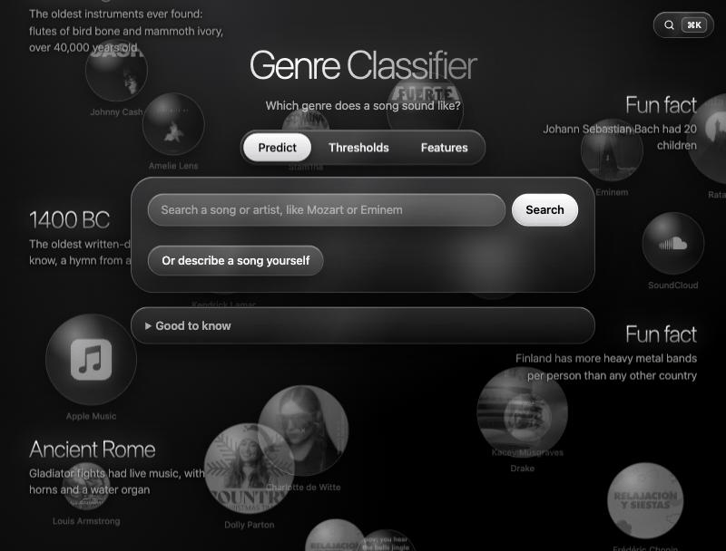

# Spotify Genre Classifier: ML in production

An app that guesses the genre of a song (classical, country, heavy-metal, hip-hop, jazz or techno) from its Spotify audio features. The model only uses how a song sounds: popularity is left out on purpose.



- `train_model.ipynb` trains the XGBoost model, tunes one threshold per genre, tests feature importance and saves everything to `models/`.
- `backend/app.py` is a Flask-RESTful backend that loads the files in `models/` and offers a REST API.
- `frontend/` is a React app that uses the API.
- `report/` has the report about ethics and usability.

## How to run it

The commands are run from the project folder (the folder with `dataset/` and `production/`).

1. Install the Python packages (only the first time):

   ```bash
   python3 -m venv .venv
   .venv/bin/pip install -r production/requirements.txt
   ```

2. Train the model (only needed if `production/models/` is empty): open `production/train_model.ipynb` and run all cells.

3. Start the backend, which runs on http://127.0.0.1:5001:

   ```bash
   .venv/bin/python production/backend/app.py
   ```

4. In a second terminal, start the frontend, which runs on http://localhost:5173. It needs Node.js.

   ```bash
   cd production/frontend
   npm install
   npm run dev
   ```

   Then open http://localhost:5173 in the browser.

5. Music videos: the app shows Apple's 30-second preview of the official video when Apple has one, and
   otherwise the video from YouTube (found through Wikidata, or YouTube's search through the dev server).
   Optional: to use YouTube's official search instead, make a free YouTube Data API key and put it in
   `production/frontend/.env.local` (this file is not committed), then restart the frontend:

   ```
   VITE_YOUTUBE_API_KEY=your-key
   ```

## The REST API

| Address | Type | What it does |
|---|---|---|
| `/` | GET | Check that the backend runs |
| `/thresholds` | GET | The current and the tuned thresholds |
| `/thresholds?jazz=0.3` | PUT | Change one or more thresholds (between 0 and 1) |
| `/songs?search=mozart` | GET | Search songs by name or artist (max 20) |
| `/predict/song?song_id=16002` | GET | Predict a song from the dataset |
| `/predict?duration_ms=219437&tempo=140.1&...` | GET | Predict a song from all 14 feature values |
| `/results` | GET | Test results (accuracy, macro F1, per genre, confusion matrix) for the current thresholds |
| `/threshold-curves` | GET | F1 for every threshold and genre, for the plot |
| `/feature-importance` | GET | Permutation importance and XGBoost total gain |
